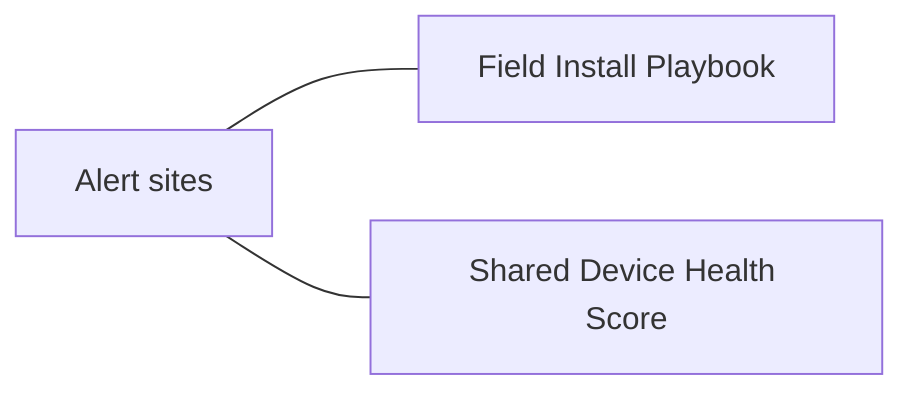

# Idea pass

Turns ideas raised in the day's meetings into linked idea notes. The value is in
the links, not in the words: short notes, many links, each with a reason.
Runs in daily-planner when it closes the day, and weekly-planner sums it up.

## Where things live

- **Ideas folder** (`IDEAS`): one folder for idea notes. `--ideas-dir` on the run,
  else `$VAULT_OS_IDEAS_DIR`, else `ideas/`.
- **Stages:** `status:` is one of `seed`, `exploring`, `building`, `done`, `killed`.
  Use the vault's own stage list if its idea dashboard has one.
- **Problems:** an idea links the problem it addresses through `solves:` in its
  frontmatter. If the problem note has an `ideas:` field, add the idea there too.
- **Link Suggestions:** links you are unsure of go to the vault's suggestions
  list as checkboxes (default `dashboards/Link Suggestions.md`; skip if the
  vault has none and say so in the report).
- **Protected folders:** never edit a note under `wiki/` (the wiki skills own
  it) or any folder the run's instructions protect. Link to those notes freely.

## Steps

1. Read each meeting in full (the transcript, not only the summary). List the
   ideas the user raised or took on. Skip other people's ideas unless the user
   committed to something about them. Skip HR, health, money and legal matters.
2. For each idea write one input line: `title`, a `summary` of one or two
   sentences in your own words, `meeting` (title only), `terms` (the names of
   things it touches: systems, projects, concepts, teams, people), and
   `commitment: true` if the user said they will do something about it, or
   `recurs: true` if it came up before.
3. Run the link finder (read-only):

   ```
   python3 PLUGIN/scripts/idea-links.py --vault VAULT --ideas-dir IDEAS < ideas.json
   ```

4. Act on each idea by its `action`:
   - `update`: add one dated line to the existing note's `## Moves` and change
     `status:` if the stage moved. Add any new sure links.
   - `create`: a new note in `IDEAS` in the shape below.
   - `daily-line-only`: no note yet. It gets a line in the daily Ideas block, and
     becomes a note when it recurs or gets a commitment.
5. Links:
   - `sure` links go on the note under `## Links`. Keep every one that a reason
     of 6 words or fewer can explain; drop the rest. No cap on links.
   - `maybe` links go to Link Suggestions, one checkbox each:
     `- [ ] [[Idea]] ↔ [[Note]] (reason)`.
   - `solves` go in frontmatter `solves:`, only when the idea plainly addresses
     the problem; otherwise treat them as `maybe`.
   - `same_meeting` ideas link each other with the reason "same meeting".
6. Aliases: for each `alias_suggestions` entry that is not `protected` and not
   `over_cap`, add the term to that note's `aliases:` frontmatter list. Change
   nothing else in that note. Protected or over-cap ones go to Link Suggestions
   as `- [ ] alias "term" → [[Note]]`.
7. New terms: a term with `create_page: true` gets a stub (concept or person,
   80 words or fewer; for a person only name, role and team). A term with
   `create_page: false` stays plain text until its second mention.
8. Write the daily Ideas block (below) and report counts: notes created and
   updated, links added, aliases added, suggestions filed, stubs made.

## Idea note shape

```
---
tags:
  - idea
status: seed
created: 2026-11-25
aliases: []
solves:
  - "[[Problem - Devices Fail Silently]]"
source: Ops sync, 2026-11-25
---
# Idea - Alert sites before devices fail

Send a site an alert when device health drops, before anyone calls support.
The user owns the first draft of the alert rules.

## Links
- [[Field Install Playbook]]: where the device data comes from
- [[Idea - Shared Device Health Score]]: same meeting

## Moves
- 2026-11-25 seed: raised in Ops sync; draft rules owed this week.
```

- The body above `## Links` is 120 words or fewer. Links do not count.
- Each `## Moves` line is dated and 15 words or fewer. One line per day at most.
- Name new notes `Idea - <short name>` unless the folder uses another pattern.

## Daily Ideas block

Written with `P block-set <today note> ideas`, 3 to 5 lines, most moved first:

```
- [[Idea - Alert sites before devices fail]] new, seed: draft alert rules owed (5 links)
- [[Idea - Shared Device Health Score]] seed → exploring: pilot site picked
- Weekly firmware pilot ring: first mention, no note yet
```

If more than 5 ideas moved, keep the 5 with commitments or stage changes and
end with `+N more in the ideas folder`.

## Weekly ideas-moved block

Written by weekly-planner with `P block-set <weekly note> ideas-moved`:

~~~
**Moved** (4)
- [[Idea - Shared Device Health Score]] seed → building
**New** (3): [[Idea - Alert sites before devices fail]], ...
**Untouched 14+ days** (2): [[Idea - ...]], [[Idea - ...]]
**Link map**

~~~

- The link map shows only ideas new or moved this week and their new links,
  12 nodes at most. Node labels are 4 words or fewer.
- Moved and Untouched come from `status:`, `## Moves` dates and file dates in
  `IDEAS`. Untouched means no `## Moves` line for 14 days or more.

## Rules

- Summaries in your own words only. No transcript text, quotes, links, numbers
  or codes from meetings or mail (see `sources.md`).
- Never edit a note outside `IDEAS` except: an `aliases:` entry (step 6), an
  `ideas:` entry on a problem note (Where things live), and checkboxes appended
  to Link Suggestions.
- Mark anything you inferred rather than heard as `(inferred)`.
